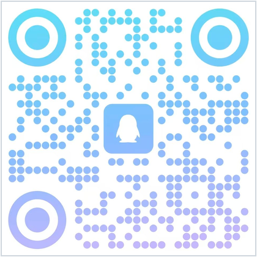

## 👋 关于我

**求职方向：AI 应用开发。**
喜欢使用 AI 进行各种尝试，擅长把想法快速做成上线成品——设计、编码、测试、打包发布全流程独立走通。
作品带图集中展示在 → **[我的作品页](https://xiaoheizi112.github.io/works/)**
代码之外的一切思考写在博客：[慢公子的小站](https://xiaoheizi112.github.io)

## 🤖 AI 开发作品（主打）

| 项目 | 一句话 | 看点 |
|---|---|---|
| [睡眠打卡 Sleep Check-in](https://github.com/xiaoheizi112/sleep-checkin-app) | Flutter 完整应用：打卡 · 统计分析 · 睡眠质量测评 | [Release 下载 APK 可直接试玩](https://github.com/xiaoheizi112/sleep-checkin-app/releases)；自研测评算法；含单元测试与产品文档 |
| [深渊幸存者 Abyss Survivor](https://github.com/xiaoheizi112/AbyssSurvivor) | Godot 4.6 / GDScript 全程 AI 结对的吸血鬼幸存者 Like | 1.4 万行代码；[Releases 免安装即玩](https://github.com/xiaoheizi112/AbyssSurvivor/releases)；9 套可重放自检 |
| [EmuHive 多开挂机框架](https://github.com/xiaoheizi112/EmuHive) | PySide6 + OpenCV + 节点图 DSL 的通用图色自动化 | 雷电4 模拟器 20~30 实例并行；不写代码拼脚本；70+ 冒烟自检 |
| [个人小站](https://github.com/xiaoheizi112/xiaoheizi112.github.io) | Hugo 静态博客与个人主页 | 持续更新的项目复盘与学习笔记 |

## 🛠 Qt 桌面课设集（已归档，只读可参考）

[记事本](https://github.com/xiaoheizi112/Notepad) · [天气预报](https://github.com/xiaoheizi112/Weather-Forecast) · [音乐播放器](https://github.com/xiaoheizi112/KYYMusic) · [DeepSeek 聊天客户端](https://github.com/xiaoheizi112/Deepseek-Chat) · [串口调试助手](https://github.com/xiaoheizi112/QtSerialPort) · [TCP 网络调试助手](https://github.com/xiaoheizi112/TCP-Network-Debugging-Assistant) · [人脸识别考勤系统](https://github.com/xiaoheizi112/Attendance-System-Based-on-Facial-Recognition)

## 📮 联系

| 微信 | QQ |
|:---:|:---:|
|  |  |

微信 `hemoumoumou01` · QQ `3866074912` · 代码指正欢迎开 [Issue](https://github.com/xiaoheizi112/xiaoheizi112/issues) 或到[博客](https://xiaoheizi112.github.io)留言
